# sprisk

sprisk is an app for analysing data and training machine-learning models. It runs on your own computer.

You build your analysis as a chain of steps: load a file, clean it, split it, train a model, measure how good the model is. sprisk draws the steps as a diagram, runs them, shows the result of every step, and warns you when a step is done in a way that would give a wrong answer.

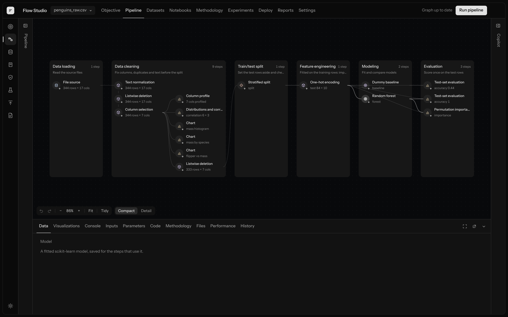

## Why it exists

It is easy to make a mistake in data analysis that nobody sees.

One example. You have 1,000 rows. You should train the model on 800 and test it on the other 200, which the model has never seen. If information from those 200 rows gets into the training by accident, the model looks much better than it really is. The code still runs and the score looks good. You only find out later, when the model fails on new data.

In a normal notebook nothing stops this. In sprisk the steps have a fixed order and a set of rules checks them. If you prepare the data before you split it, sprisk tells you.

## How you use it

1. Add a data file, for example a CSV.
2. Add steps. Each step does one thing.
3. Press **Run pipeline**.
4. Click any step to see its table, its charts, its code and its log.
5. Change something and run again. Steps that did not change are not run again. Old runs are kept, so you can compare.

## The screens

### Pipeline

The picture at the top of this page. Each box is a stage and each row inside it is a step. This example predicts the species of a penguin from its measurements. The data is loaded, cleaned and charted. Then some rows are set aside for testing. Only after that are the models trained.

Click a step and the panel at the bottom shows what that step produced.

### Charts

A chart is a step like any other. You pick the chart type and the columns.

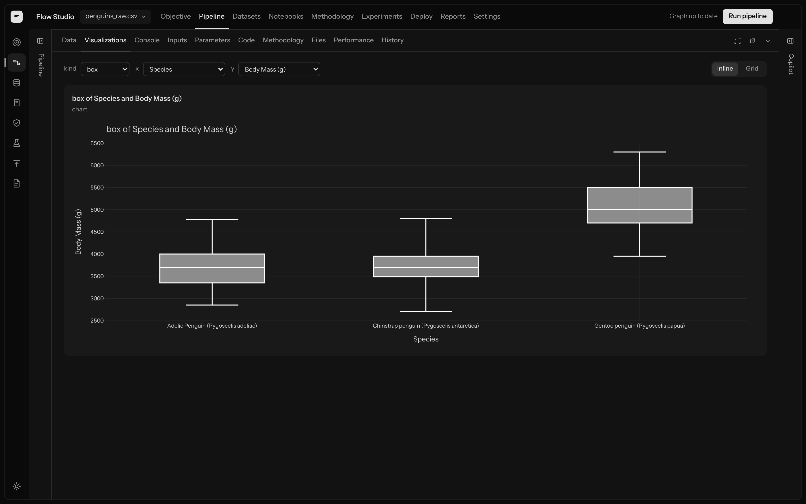

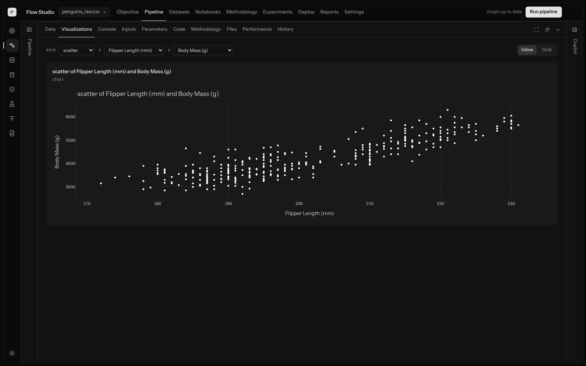

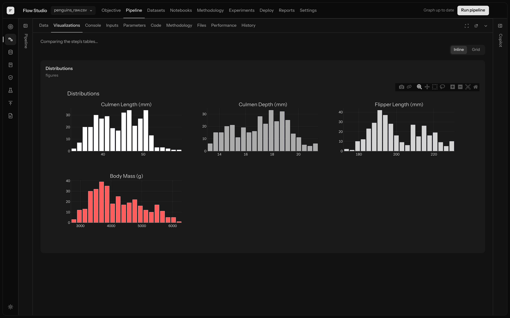

Charts written in your own Python code show up the same way:

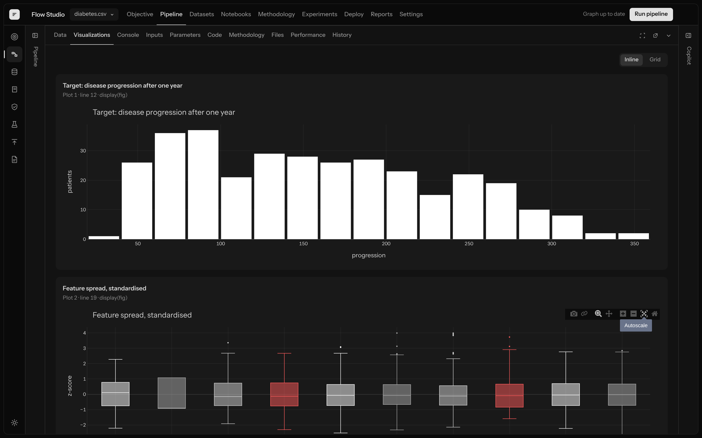

### Model results

After a model is tested, sprisk shows where it was right and wrong. In this table each row is the true species and each column is what the model said. All test penguins are on the diagonal, so all were classified correctly.

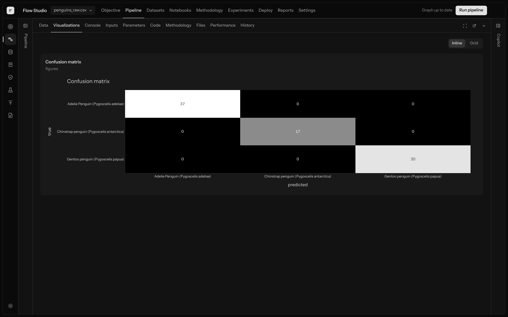

Which columns the model relied on most:

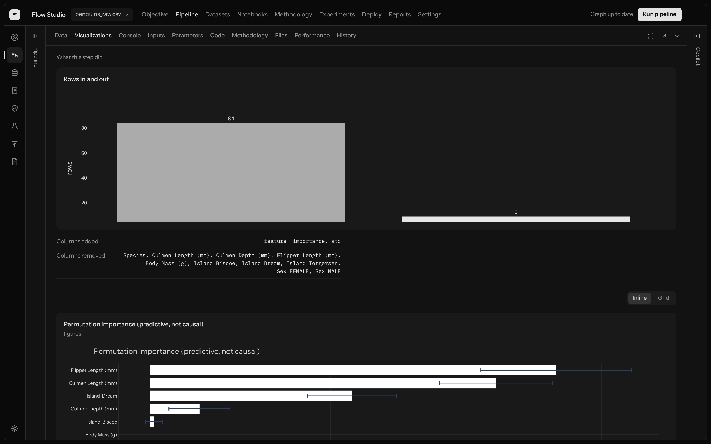

Four models compared on the same data, five times each. Lower is better:

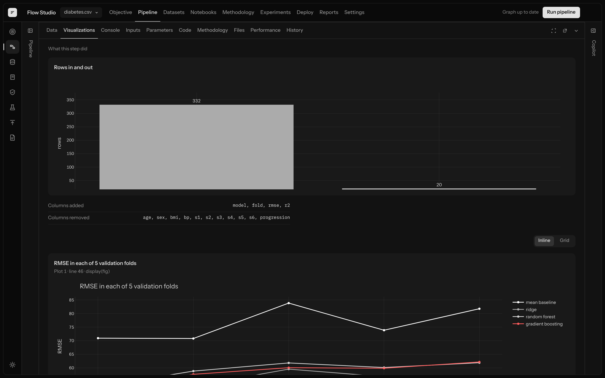

The errors of the chosen model, to check there is no pattern left in them:

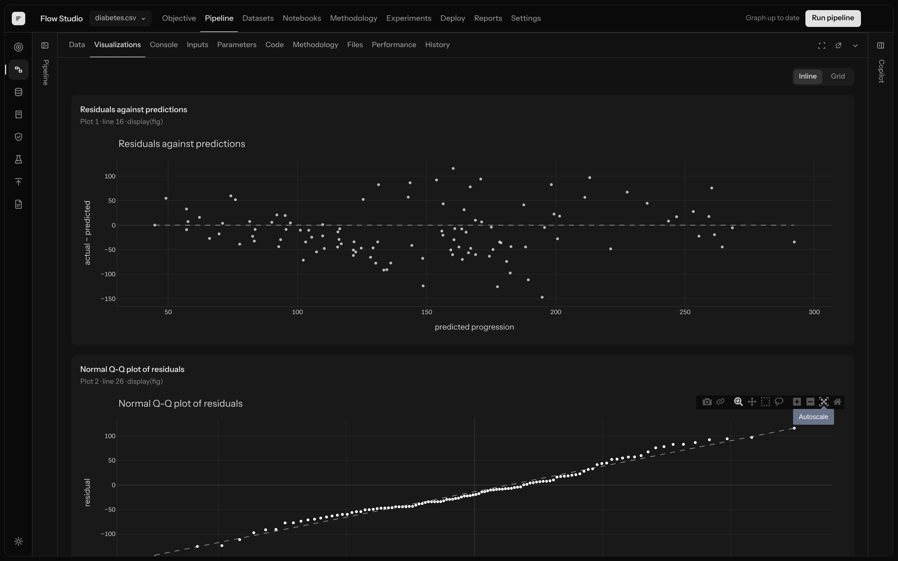

### Datasets

A summary of each file: how many rows and columns, how many empty cells, and a small histogram above every column.

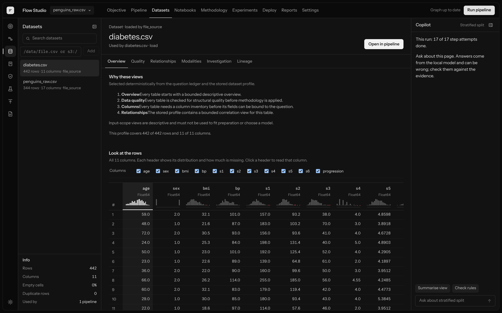

Which columns move together, and whether the training rows and the test rows look alike:

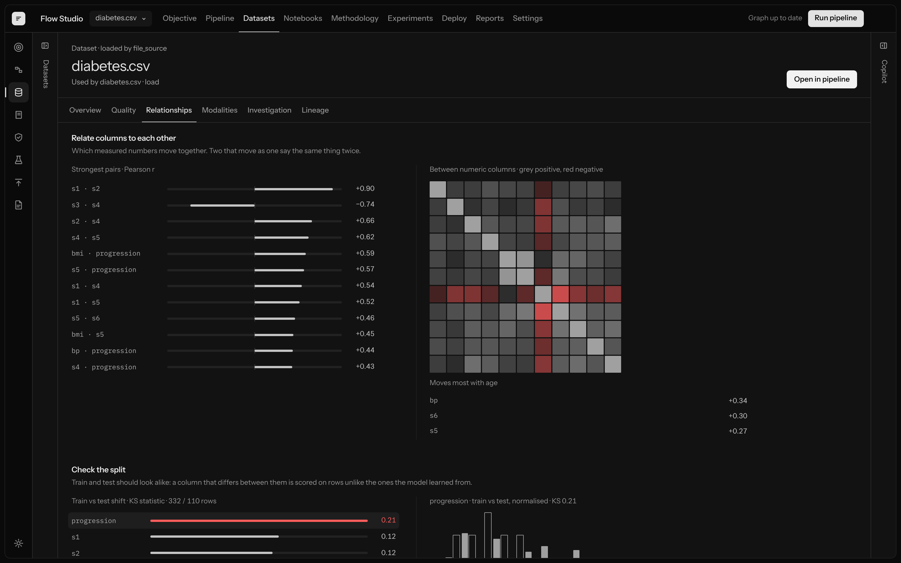

The summary numbers for each column, as a step in the pipeline:

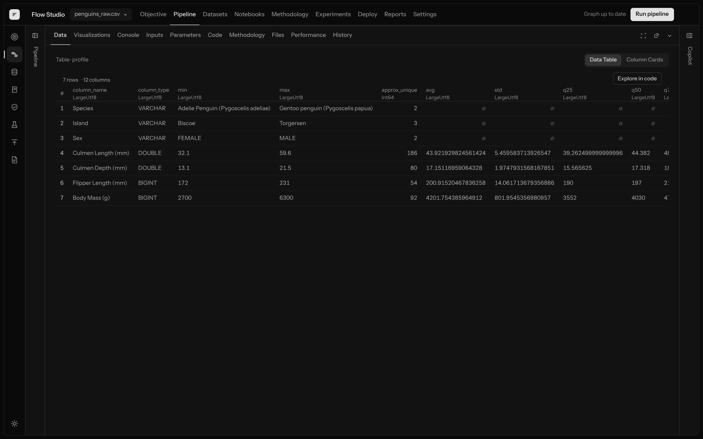

### Methodology

This is the list of rules sprisk checks, drawn as a map. Examples: is one class much rarer than the others, is there an ID column that should not be used, are there duplicate rows. Each rule is a short Python file you can open and read.

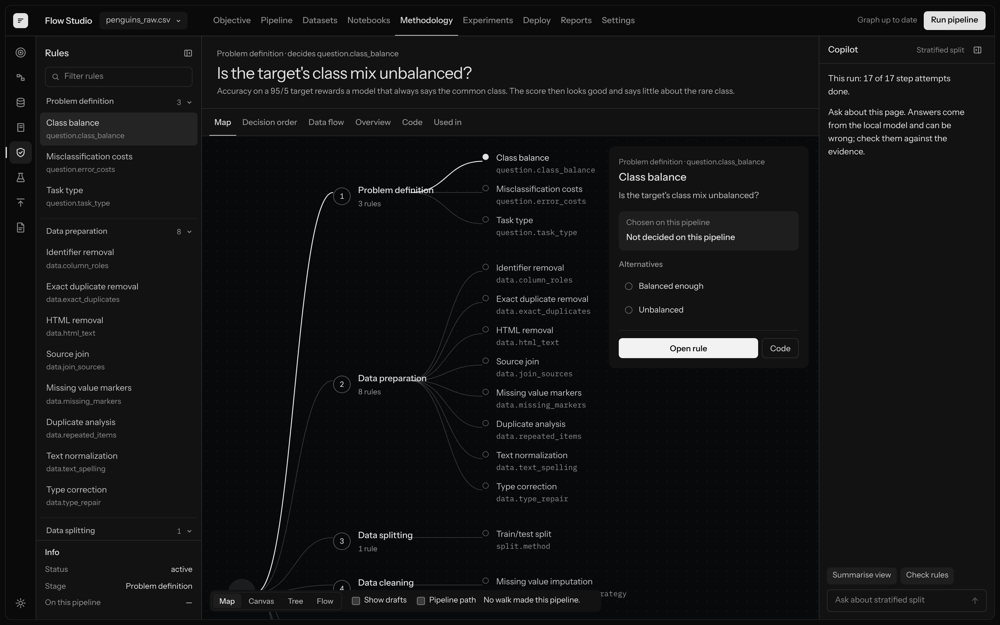

### Notebooks

The same pipeline shown as a notebook. One cell per step, with its output below. You can also import an existing Jupyter notebook and sprisk turns it into steps.

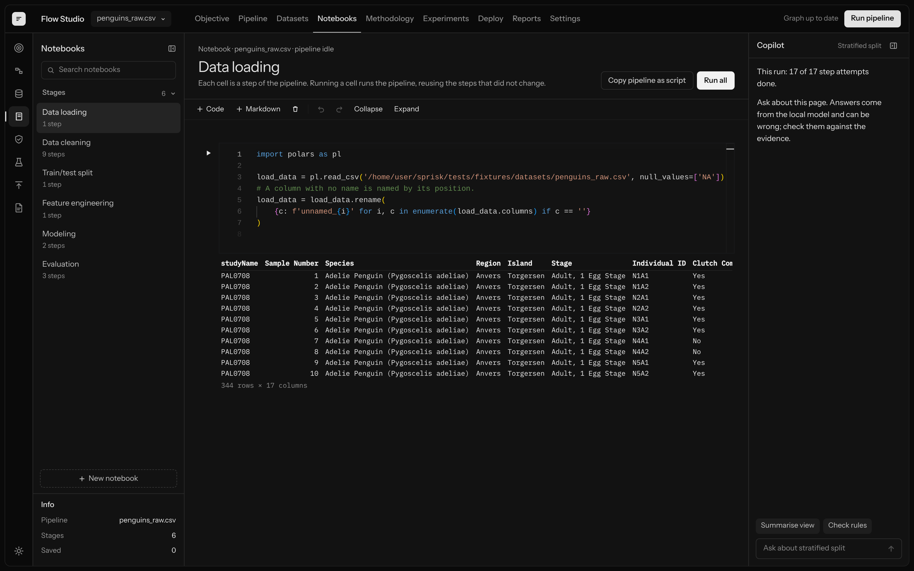

### Experiments

Every run is saved with the status of each step. Run twice and you can compare the two.

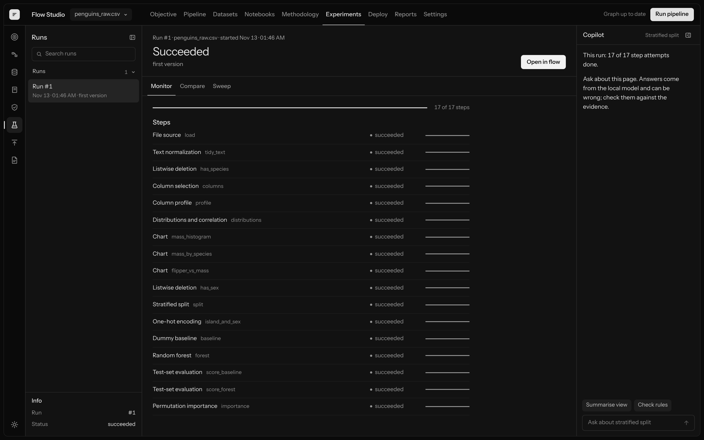

## Other things to know

- Your data stays on your computer. Nothing is sent to an outside AI service unless you turn that on.
- There is an AI assistant (Copilot). It can suggest steps. It cannot run code by itself: every suggestion goes through the same checks as a step you add by hand.
- The maths is done by well-known libraries: scikit-learn, SciPy, statsmodels, Polars and DuckDB.
- Finished runs and results are never changed afterwards. A re-run is saved as a new run.

## Run it

You need Rust, Python with [uv](https://docs.astral.sh/uv/), and Node with pnpm.

```bash
uv sync                                   # Python part
pnpm install                              # web app
cargo run -p sprisk-cli -- serve          # starts the local server on 127.0.0.1:7420
pnpm -C apps/web dev                      # opens the app on http://127.0.0.1:5173
```

To load the penguin example (run from the repository folder):

```bash
sed "s#\$DATASETS#$PWD/tests/fixtures/datasets#g" tests/fixtures/pipelines/penguins.yaml > /tmp/penguins.yaml
cargo run -p sprisk-cli -- run /tmp/penguins.yaml
```

Then open the app. The run is there.

## How it is built, and why Rust and Python

sprisk is three programs that work together:

```
 Browser app            Rust server                     Python worker
 (React, TypeScript)    (one program)                   (a separate process)

 shows the diagram ───► stores pipelines and runs  ───► loads the file
 and the charts   HTTP  checks the pipeline       JSON  cleans, splits, trains
                 ◄───── decides what runs and when ◄─── draws charts
                        saves every result              reports back
```

**Python does the data work.** Reading files, cleaning, statistics, training models and drawing charts are all Python, because the libraries everyone trusts for this are Python libraries: scikit-learn, SciPy, statsmodels, Polars, DuckDB. sprisk does not rewrite any of that maths. The rules that check your method are Python too, so a data scientist can read and change them.

**Rust is the program you actually start.** When you run `sprisk serve`, that is a Rust program. Python does not start on its own; the Rust program starts it when a step needs to run. About half of the code in this repository is Rust.

Rust never does statistics or trains a model. It does everything *around* that. The clearest way to see it is to follow one click.

**What happens when you press "Run pipeline":**

| # | What happens | Who does it |
| --- | --- | --- |
| 1 | The browser sends the pipeline to the server. | Rust (`sprisk-api`) |
| 2 | The server checks the pipeline: does every step exist, does each step get the kind of input it needs, are the settings valid, is there a loop. If something is wrong you get the full list of problems and nothing runs. | Rust (`sprisk-graph`, `sprisk-registry`) |
| 3 | The pipeline and a new run are written to the database. | Rust (`sprisk-store`, SQLite) |
| 4 | The steps are put in order. For each one the server asks: have I already run this exact step with this exact input and these settings? If yes, it reuses the saved result and skips the step. | Rust (`sprisk-scheduler`) |
| 5 | For a step that must run, the server starts a Python worker (or reuses one) and sends it the step. | Rust (`sprisk-scheduler`) |
| 6 | The worker reads the file, cleans, trains, draws the chart, and writes the output to a temporary folder. | **Python** |
| 7 | The server reads that output back, computes its checksum, and compares it with what the worker claimed. Only if they match is the result moved into permanent storage and recorded. | Rust (`sprisk-artifacts`) |
| 8 | The step is marked succeeded or failed, and the next step starts. If the worker crashed or took too long, the server stops it and records the failure. | Rust (`sprisk-scheduler`, `sprisk-core`) |
| 9 | The browser asks for the result. The server reads just the rows that fit on screen from the saved table and sends those. | Rust (`sprisk-api`, `sprisk-artifacts`) |

So in nine steps, Python does one: the actual data work. Rust does the other eight.

**The Rust parts, one line each:**

| Part | What it does |
| --- | --- |
| `sprisk-api` | The web server. Every button in the app ends up as a request here. |
| `sprisk-store` | The database of pipelines, runs, steps and results. |
| `sprisk-registry` | Reads the description file of every available step, so the server knows what steps exist and what they accept. |
| `sprisk-graph` | Checks a pipeline and works out the order of its steps. |
| `sprisk-scheduler` | Runs the steps: starts workers, sends work, handles reuse, timeouts, crashes and retries. |
| `sprisk-artifacts` | Stores result files, verifies them by checksum, and reads pages of rows for the screen. |
| `sprisk-methodology` | Keeps the catalog of rules and methods and records which choice was made at each point. The rule code itself is Python; this part decides when a rule runs and stores its answer. |
| `sprisk-core` | The shared definitions, such as the allowed states of a step (queued, running, succeeded, failed, timed out, cancelled). |
| `apps/cli` | The `sprisk` command line program that ties it all together. |

**Why not Python for everything?** Because the part that checks and records should not be the same program that runs your code. A step can crash, run out of memory or hang. If that happened inside the server, it would take the run history down with it. With two programs, the Python worker can die and the Rust server just marks that step as failed and carries on. Rust is also strict in a way that suits bookkeeping: a run can only be in one of a fixed set of states, and the compiler refuses code that forgets one.

The same split is the safety rule for the AI assistant. The assistant runs on the Python side and can only *suggest* a pipeline. The Rust server decides whether it may run. The program that proposes is never the program that approves.

**How they talk.** The Rust server starts the Python worker as a child process and they send each other short JSON messages, one per line: "run this step with these inputs", "done, here is the result", "failed, here is why". Tables are never sent through these messages. The worker writes them to disk as files and sends back only the file's name and checksum. The browser talks to the Rust server over normal HTTP and never talks to Python directly.

**One definition for every message.** The shape of every message and record is written once, as a schema in `contracts/`. The Rust, Python and TypeScript types are generated from it. So the three languages cannot disagree about what a "run" or a "step result" looks like.

**Adding a new step.** A step is a small Python package: a function plus a short file describing its inputs, outputs and settings. You add it under `plugins/`. Nothing in the Rust server has to change.

| Folder | Language | What it is |
| --- | --- | --- |
| `apps/web/` | TypeScript | The app you see in the browser. |
| `apps/cli/` | Rust | The `sprisk` command that starts the server and runs pipeline files. |
| `crates/` | Rust | The server: API, database, pipeline checks, scheduler, result storage. |
| `python/` | Python | The worker that runs steps, plus the AI assistant. |
| `plugins/` | Python | The steps you can add to a pipeline. |
| `methodology/` | Python | The rules that check your method. |
| `contracts/` | JSON Schema | The message and record definitions shared by all three languages. |
| `docs/` | Markdown | Design documents. |

## Status

sprisk is still being built. It works on one computer with the examples above. It is not ready for production use.

More detail: [architecture](docs/architecture/sprisk-enterprise-platform-design-v2.md) · [what is built and what is not](docs/architecture/architecture-integration-map.md) · [all docs](docs/README.md)
