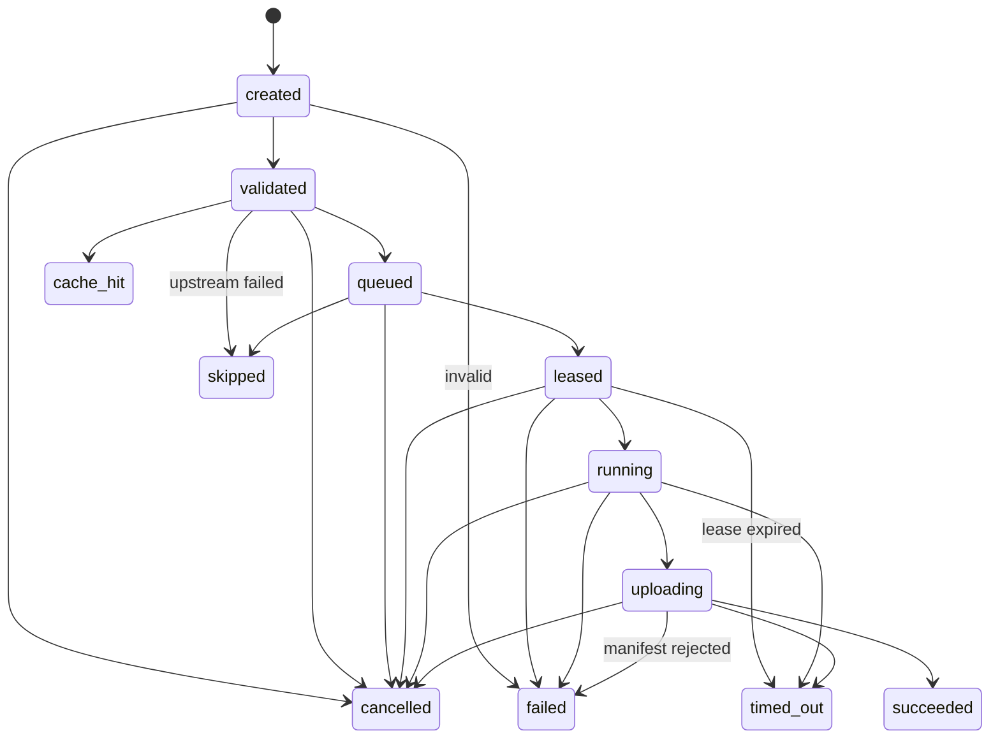

# ADR-0013: Attempt state machine

Status: Accepted
Date: 2026-10-15
Arch doc sections: §9

## Context

§9 lists attempt states but not which moves between them are legal. The scheduler, worker protocol and UI all depend on one answer.

## Decision

An attempt moves forward only. Terminal states never change. A retry is a **new** attempt with the next `number`; the old one stays as it ended.

Terminal: `succeeded`, `failed`, `cancelled`, `timed_out`, `skipped`, `cache_hit`.

## Rules

- `cache_hit` only from `validated`: the cache is checked before queuing.
- `skipped` only before a worker holds the attempt.
- Lease expiry is `timed_out`, never back to `queued`. The scheduler creates a new attempt.
- A late message for a terminal attempt is rejected, so it can never overwrite a newer result (§9 step 8).

## Consequences

- One function, `sprisk_core::attempt::transition`, is the only way to change state. Repositories call it before every write.
- The transition table is tested exhaustively (every state pair).

## Validation

Exhaustive transition test in `crates/sprisk-core`.
