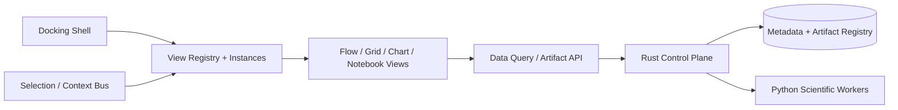

# sprisk — System Architecture & Design Baseline

**Status:** Proposed architecture baseline, revision 1.2 (not an implementation claim)  
**Date:** 15 October 2026  
**Revision note:** 1.1 added the frontend workbench. 1.2 renamed domain entities for consistency (ADR-0012).  
**Scope:** Open-source, local-first, AI-native data-science, ML, experimentation, and decision-intelligence platform.  
**Design target:** One complete investigation from a natural-language goal to an executable, validated, reproducible result, with a path to collaborative hosting.

## 1. Product boundary and non-negotiable principles

sprisk is a general-purpose analytical platform organized around scientific investigation, not a fixed customer-churn product or a chat interface that writes scripts. It supports manual, programmatic, and AI-driven operation through **the same registered capabilities and typed execution contracts**.

1. **AI plans; the trusted platform authorizes; workers compute; evidence records what happened.** Language-model output is never an execution permission or a scientific verdict.
2. **Methodology-first, not methodology-restricted.** Analyses may produce findings without models, and models without operational decisions; hypotheses may be rejected.
3. **Separate computational, scientific, and decision semantics.** DAG nodes, experiment runs, findings and decisions are different objects.
4. **Open interfaces, local-first deployment.** The core engine must run without an account or cloud service. Hosted deployments reuse the same contracts.
5. **No silent data transfer.** Local and external AI providers are interchangeable; outbound dataset context requires explicit policy and consent.
6. **No silent scientific conclusions.** Every claim references supporting evidence, assumptions, caveats, and applicable methodological checks.
7. **No reimplementation of mature numerical libraries.** Python's ecosystem supplies algorithms; sprisk supplies orchestration, scientific discipline, integration, and provenance.
8. **Avoid premature microservices.** A Rust modular monolith coordinates independent Python planning and compute processes.

**Non-goals for initial release:** full Dataiku feature parity; arbitrary distributed cluster support; a proprietary dataframe engine; custom ML algorithms; autonomous production actions; general-purpose multi-user cloud governance; guaranteed scientific correctness of arbitrary custom code.

## 2. Chosen technology stack

| Layer | Decision | Why / boundary |
| --- | --- | --- |
| Web application | React + TypeScript + Vite | Presentation only; no authoritative computation or methodology rules. |
| Dockable workbench | `dockview-react` (preferred; validate against `flexlayout-react`) | Split/tab/floating/popout analytical views, persisted layouts; keep docking implementation behind an adapter. |
| Workflow canvas | `@xyflow/react` (React Flow) + ELK.js as needed | Editable typed graph projection; backend `Pipeline` remains authoritative. |
| UI primitives | Radix UI + shadcn/ui patterns | Accessible controls and customizable design tokens; avoid coupling to a dashboard template. |
| Data grid and exploration | AG Grid Community; optional FINOS Perspective | Virtualized data browsing; cross-filter/pivot only where needed and license-compatible. |
| Charts and code | Apache ECharts + Plotly.js adapter; Monaco Editor | Pluggable analytical visualizations and code editing; avoid rendering entire datasets in the browser. |
| UI data/state | TanStack Query + Zustand | Server-state fetching and local ephemeral workbench state, kept separate from versioned scientific objects. |
| Core control plane | Rust, Axum, Tokio | API, registry, graph compilation, durable scheduling, policies, provenance, storage abstraction. |
| Rust persistence | SQLx + SQLite (local), PostgreSQL (hosted) | Same repository interfaces; dialect-specific migrations and tests. |
| Python scientific plane | Python, Pydantic, scikit-learn, SciPy, statsmodels | Structured AI planning, scientific validators, ML/stats execution. |
| AI providers | Local model adapter and external provider adapter(s) | Consent-gated data exposure, structured outputs, provider-independent planning interface. |
| Data processing | DuckDB + Polars; Arrow interoperability | SQL/lazy frames, efficient profiling and transformations. |
| ML extensions | XGBoost, LightGBM, PyTorch, Hugging Face (as required) | Optional adapters, not universal core dependencies. |
| Search/optimization | Optuna; OR-Tools when decisions require mathematical optimization | Constrained, versioned study runs; do not rely on LLM trial selection alone. |
| Artifact data | Parquet, Arrow IPC, model bundles; filesystem local / S3 API hosted | Immutable artifacts with content hashes and metadata. |
| API/IPC | HTTP+JSON for control, process IPC for local workers, Arrow IPC or artifact refs for datasets | Avoid full dataframes embedded in JSON commands. |
| Observability | tracing/OpenTelemetry; structured run events | Operations telemetry separate from immutable scientific run records. |
| Desktop packaging | Tauri **later** | Python environment bundling, code execution isolation and installers need validation first. |
| Interoperability | OpenLineage and MLflow adapters | External standards/adapters; do not make either sprisk's primary state database. |

### Rust / Python ownership rule

**Rust owns:** identity, permissions, registry resolution, graph typing, scheduling, lease/retry/cancellation, cache policy, artifact commits, immutable run history, approval gates, APIs, event distribution.

**Python owns:** dataset profiling algorithms, transformations, feature engineering, ML/statistics, experiment strategy, scientific checks, local/remote LLM interactions through the AI planner, report analysis.

**Neither owns by duplication:** graph schemas are versioned in one `contracts/` source. Rust validates structural and authorization invariants; Python validates scientific semantics and may block plans through a versioned methodology report. Rust enforces the report's gates.

## 2A. Frontend workbench architecture (revision 1.1)

**Reference:** the existing `sprisk-studio.html` is a *concept and interaction reference*, not an execution or data contract. Its cockpit (top bar with project/flow switcher first, step library, Flow canvas over the Decision/Code/Data/Logs inspector, Copilot) is the default dock layout, and its five views are Flow, Datasets, Notebooks, Experiments and Deploy (ADR-0018; screens in `docs/design/screens/`). Preserve its workflow-focused organization while replacing fixed CSS-grid panels with a general-purpose scientific workbench. The architectural model is closer to Blender/JupyterLab/VS Code than to a dashboard framework.

### Stack and selection status

| Concern | Recommended choice | Decision status / constraint |
| --- | --- | --- |
| Docking and window groups | `dockview-react` | **Preferred**, subject to an end-to-end proof of concept. Compare against MIT-licensed `flexlayout-react`, including keyboard accessibility, popout behavior, nested resizing, license features, and chart/graph lifecycle. |
| Executable workflow editor | `@xyflow/react` with custom node and edge components | **Chosen direction**. React graph is a view/editor of canonical `Pipeline`; it is not the engine, compiler or registry. |
| Automatic graph layout | ELK.js | Optional for AI-generated workflows, with manual layouts retained independently from pipeline graph structure. |
| Components / styling | Radix UI primitives, shadcn/ui patterns, tokenized design system | **Chosen direction**; no bundled dashboard theme or AI-specific visual styling requirements. |
| Tables and analytics | AG Grid Community; FINOS Perspective where useful | Community license baseline, advanced grid/pivot capabilities reviewed before implementation. Do not assume AG Grid Enterprise features are free. |
| Charts | Apache ECharts (general); Plotly.js through scientific visualization adapters | Both are **candidate adapters**, not mandatory dependencies of every view. Use a renderer registry; limit loaded libraries per view. |
| Code and notebooks | Monaco Editor; a Jupyter kernel (`ipykernel` driven by `jupyter_client`) per open notebook, started by Rust (ADR-0036) | Monaco edits code; the browser only calls the Rust API. Session results are scratch; nodes made from notebook cells run in authorized Python workers. |
| Data fetching & view state | TanStack Query for API/cache; Zustand for local UI context | Server-side scientific state remains with Rust metadata/artifacts, not in UI state. |
| Desktop | Browser against localhost Rust API; Tauri later | Must prove local Python runtime installation and window/process lifecycles before packaging. |

**Licensing policy for an open-source platform:** prefer OSI-licensed core dependencies. Dockview core is MIT; some advanced enterprise UI features are commercial. FlexLayout is an MIT alternative. React Flow is MIT, while some separately sold examples/templates have different terms. AG Grid Community is MIT; do not silently rely on Enterprise components. Audit bundled assets and licenses before a public release.

### Workbench object model

The **Workbench View Registry** is independent of the **Operator/Capability Registry**:

- `ViewType`: stable view type ID, renderer, accepted artifact/context kinds, available actions and serialization version; e.g. `workflow`, `dataset`, `distribution`, `correlation`, `experiment-comparison`, `model-diagnostics`, `evidence`, `code`, `notebook`, `ai-investigation`, `question-brief`, `outcomes`, `logs`.
- `ViewInstance`: unique instance ID, type, title, context references (`project_id`, `investigation_id`, and optional `node_id`, `artifact_id`, `run_id`, `experiment_id`), user-controlled settings and `follow_selection` versus `pinned` mode.
- `WorkspaceLayout`: separately versioned UI-only dock topology and geometry (groups, tabs, pane sizes, active view), saved as a per-user/per-project preference; layout migration is independent of scientific schema migrations.
- `WorkbenchContext`: current project, active investigation, selected node/artifact/run and synchronized filters. Events are typed; a view can follow selection, pin a snapshot, or compare two references side-by-side.
- `Inspector`: nine tabs for the selected step, named and ordered as fixed: Code, Data, Visualizations, Console, Inputs, Parameters, Checks, Performance, History. What fills each tab is read from the step's code (ADR-0025). Data is a variable explorer; Visualizations shows only what the code drew (ADR-0030, ADR-0032). Checks, Performance and History come from sprisk, not from the step.
- `Visualization`: view configuration (chart type, metric/field references, transforms, selection/filter settings, provenance reference) consumed by pluggable renderers. This is not a raw dataframe or arbitrary chart execution script.

**Hard separation:** closing, moving or duplicating a dock never modifies/deletes an analytical node, model, dataset, experiment or evidence record. Conversely, editing an actual pipeline is an explicit mutation resulting in a new `PipelineVersion`, regardless of which dock initiates it. Layout state is not scientific provenance.

### Architecture and data flow



- **Data locality:** API pagination, projection/filter pushdown, aggregates, sampling and streamed results; never transfer a whole multi-GB dataset for a view. Visualizations reference versioned artifacts and query specs.
- **Lifecycle & performance:** lazy-load heavy panels (React Flow, Monaco, scientific chart libraries); resize-aware renderers, visibility-aware refresh, window virtualization, and controlled caching. Hidden tabs must not eagerly recompute expensive diagnostics.
- **Detached windows:** popout documents complicate editor/chart bindings, event routing, credential scoping and native desktop packaging. Test before guaranteeing cross-window behavior.
- **Notebook security:** a code editor is not a compute permission. A notebook cell runs only through the Rust API, in a kernel Rust starts with a per-cell time limit, a memory cap, an idle shutdown and a cap on live kernels; each execution is audited by its code hash (ADR-0036). Session results are scratch, never artifacts or evidence. A node made from cells goes through the same authorization, worker isolation, artifacts and provenance contracts as any graphical workflow.
- **Extensions:** frontend plugins register view *types*, not executable analytical capabilities. Rendering a result produced by a new backend operator should work through a default artifact inspector even without a custom visualizer.

### Frontend proof-of-concept gate

Use the current Flow, Data, Analysis, Code and Logs concepts; also register Question Brief, Experiment Comparison and Outcomes. Verify all of the following before choosing a final docking dependency:

1. Split, resize, reorder, maximize, close and restore 10+ heterogeneous docks, and persist/restore layout across reloads.
2. Open two independent chart instances and a table for the same artifact; pin one to a prior run while another follows selection.
3. Move graph/table/Monaco views without breaking editor state, renderer sizing or Rust event subscriptions.
4. Display large tables through server-side filtering/pagination or virtualization without browser-memory copying of the full source dataset.
5. Restore an older, versioned layout that references a now-unavailable view type by showing a safe placeholder, not failing startup.
6. Confirm the chosen open-source dependency covers all *required* dock behavior, without a mandatory commercial feature.

### Sources and decision references

- Dockview: https://dockview.dev/docs/overview/introduction/ and https://dockview.dev/docs/overview/licence
- FlexLayout: https://github.com/caplin/FlexLayout
- React Flow: https://reactflow.dev/ and https://xyflow.com/open-source
- AG Grid Community license: https://www.ag-grid.com/eula/community/
- Perspective: https://perspective.finos.org/

## 3. Deployable topology

```mermaid
flowchart TB
  CLIENT[React / CLI / Python SDK] --> API[Rust Axum API]
  API --> CTRL[Rust Control Plane]
  CTRL <--> META[(SQLite locally / Postgres hosted)]
  CTRL --> P[Python AI Planning Worker]
  CTRL --> S[Rust Scheduler]
  S --> W[Isolated Python Compute Worker(s)]
  W <--> STORE[(Filesystem or S3 Artifacts)]
  CTRL <--> STORE
  W --> RESULTS[Metrics / Diagnostics / Findings]
  RESULTS --> CTRL
  CTRL --> OUT[Evidence / Decisions / Outcomes]
  OUT -. feedback .-> P
```

Initial deployments: (1) one Rust binary plus managed, trusted Python worker processes and local filesystem/SQLite; (2) hosted form with Postgres, S3-compatible storage, worker isolation and durable attempt coordination. These are deployment profiles, **not two codebases**. Python planner and compute processes may share a packaged environment at first but must have different credentials and permissions.

## 4. Domain model (source of truth)

**Naming rules (ADR-0012):** entities are plain nouns. An immutable snapshot of an entity is `<Entity>Version`. Never add `Spec`, `Definition` or `Info`. A run executes a pipeline version; each node becomes a `Step`; each try of a step is an `Attempt`. The word "job" is not a domain term.

| Entity | Meaning | Mutable? |
| --- | --- | --- |
| `Project` | Organizes resources, access policy and investigations. | Mutable settings, versioned policy. |
| `Investigation` | The overarching inquiry, including analyses without decisions. | Mutable pointer to current versions. |
| `Question` / `QuestionVersion` | Formal objective, task, data facts, assumptions, unknowns, acceptance criteria. | Immutable versions. |
| `Dataset` / `DatasetVersion` | Data identity; frozen snapshot or external versioned reference. | Version immutable. |
| `Operator` | Registry metadata, interface, permissions and implementation version. | Immutable version. |
| `PipelineVersion` | Compilable typed graph using pinned operator versions. | Immutable. |
| `Run` / `Step` / `Attempt` | A run executes one pipeline version against inputs. Each node is a step; each try of a step is an attempt. | Append-only history plus transactionally maintained current status. |
| `Artifact` | Content-addressed output with declared schema and source. | Immutable bytes and metadata. |
| `ExperimentStudy` / `Trial` | Evaluation protocol, search space, candidate configurations, results. | Study state mutable; trial records immutable at completion. |
| `MethodologyCheck` | Rule verdict, version, rationale, observed evidence and limitations. | Immutable per check execution. |
| `Finding` / `EvidenceClaim` | Proposition, supporting/contradicting sources, uncertainty and scope. | Versioned, not overwritten. |
| `Assumption` | Explicit unverified or context-supplied proposition, with status and owner. | Versioned. |
| `DecisionCase` / `DecisionRelease` | Alternatives, constraints, approval and frozen conditional action. | Case evolves; release immutable. |
| `OutcomeObservation` | Later measurements tied to a release, treatment, evaluation plan and cohort. | Append-only correction-aware observations. |
| `Notebook` / `NotebookVersion` | Ordered code and Markdown cells explored on a live kernel (ADR-0036). Its outputs are not saved. | Immutable versions. |
| `AIPlanningSession` / `PipelineProposal` | Prompted context, model/provider, proposals, token costs and accepted changes. | Append-only proposals and tool actions. |

Three linked graphs:

- **Execution DAG:** operators → dependencies → outputs. Must be acyclic for one pipeline version.
- **Evidence graph:** finding/claim ↔ supporting/contradicting records ↔ experiment/artifact, including uncertainty.
- **Decision graph:** objectives, alternatives, assumptions, constraints, approvals, releases and measured outcomes.

Never force reasoning feedback loops into the execution DAG. An `Evaluate → revise features` loop creates a new pipeline version/trial, linked by provenance.

## 5. Typed operator and pipeline intermediate representation

Every human, script, or agent selects from a shared registry. An operator declares:

- Identity/version and entrypoint/runtime; input and output **ports** with typed schemas.
- Data semantics: column roles, target and entity IDs, temporal meaning, fitted state, training/inference contexts. Operators that learn from data take `train` and `test` and fit on `train` only (ADR-0018).
- Preconditions and methodological checks; parameters/defaults/constraints.
- Resources: CPU, GPU, memory, duration; sandbox and network permissions.
- Purity, side effects, nondeterminism and cache eligibility.
- Capability class: source, transform, analyzer, estimator, evaluator, optimizer, decision evaluator, sink, custom code.
- Provenance/diagnostics emitted by the worker.

Illustrative `Pipeline` fragment:

```yaml
schema_version: sprisk.pipeline/v1
version_id: plv_010
nodes:
  - id: ingest
    operator: sprisk.source.parquet@1.0.0
    params: { dataset_version: dv_004 }
  - id: split
    operator: sprisk.validation.temporal_split@1.0.0
    params: { time_column: order_date, reserve_final_holdout: true }
  - id: train
    operator: sprisk.ml.sklearn_pipeline@1.0.0
    params:
      preprocessing:
        numeric: { missing: median, scale: standard }
      estimator: logistic_regression
  - id: evaluate
    operator: sprisk.eval.binary_classification@1.0.0
    params: { primary_metric: average_precision }
edges:
  - { from: ingest.data, to: split.data }
  - { from: split.train, to: train.training_data }
  - { from: train.model, to: evaluate.model }
  - { from: split.validation, to: evaluate.validation_data }
```

The above is **illustrative**, not a complete leakage-safe protocol: model selection evaluates on validation folds/data, never a repeatedly consulted final test set. A production `ExperimentStudy` protocol must represent folds, train/test role constraints, target-horizon availability, model-selection access, and test-set sealing. For cross-validation, the fitted preprocessing and feature selection are performed separately **inside each training fold**, not globally beforehand.

The Rust compiler handles schema validation, registry resolution, typed-port compatibility, graph cycles, permissions, resource feasibility and version pinning. Python methodology validators handle model-specific and domain-dependent correctness; some risks are intrinsically not machine-decidable and require explicit acknowledgment.

## 6. Capability architecture

Capabilities are **packages** with manifest + implementation + contract tests. Not every capability is a pipeline operator.

| Extension | Examples |
| --- | --- |
| Connector | CSV/Parquet, SQL, API, cloud warehouse, streaming source |
| Operator | Join, missing-values profile, impute, fit, predict, evaluate |
| Methodology pack | Classification, regression, forecasting, anomaly detection, causal design |
| Experiment strategy | Cross-validation, randomized search, Optuna study, ablations |
| Scientific validator | Target leakage, temporal validation, group splitting, sample power checks |
| Visual/result serializer | Typed plot data, explanation/diagnostic output |
| AI provider/tool | Local model, external LLM adapter, authorized capability discovery |
| Deployment adapter | Batch execution, REST endpoint, external serving environment |
| Outcome collector | Imports measured actions, treatment allocation, business outcomes |

The first release should support exploratory analysis, classification and regression, with a modest trusted operator set. Causal and operational decision packs come later, but domain contracts must already allow them.

## 7. AI-native planning and investigation system

### Logical components (not independent services)

1. **Intent interpreter:** turns a user goal into structured `Question` / `QuestionVersion`; every field carries `origin = explicit | inferred | measured | confirmed`, with unresolved fields indicated.
2. **Context retriever:** obtains authorized schema/profile summaries, capability manifests, resource budgets and prior experiment records. Never sends raw data externally without explicit permission; profile metadata can also be sensitive.
3. **Methodology planner:** chooses a strategy based on task semantics, evidence requirements, evaluation design, constraints and available capabilities. Deterministic rules are authoritative where formalizable.
4. **Pipeline synthesizer:** produces a versioned, typed `PipelineProposal`; never arbitrary executable text as the default path.
5. **Experiment optimizer:** uses search algorithms for parameters and models; agent proposes higher-level methodological changes based on actual results.
6. **Explanation generator:** translates verified findings, alternative outcomes and unresolved assumptions into a Question/Investigation/Decision Brief.

### Agent control loop

```text
GOAL_RECEIVED
  → PROFILE_REQUESTED → GOAL_SPEC_DRAFTED
  → PLAN_PROPOSED → STATIC_VALIDATION
  → [REPAIR_WITH_BOUNDED_RETRIES | NEEDS_USER_DECISION | READY]
  → APPROVED_EXPERIMENT → EXECUTION
  → EVALUATION → [STOP_AND_REPORT | PROPOSE_NEW_REVISION]
  → (next bounded iteration) → REPORT
```

**Guardrails:** maximum wall time, trials, compute, token spend, dataset access, local/external provider policy, plan-repair attempts and experiment-version depth. AI cannot elevate privileges or change the protected final holdout to improve results. Deployments, communications and destructive operations require separate approval even if investigation autonomy is enabled.

Three autonomy modes: `assist` (proposals), `execute_approved` (can run approved plan within budget), `bounded_autonomous` (may propose/run permitted experimental versions but not production side effects). All use the same graph compiler.

## 8. Methodology and scientific validity

**Gate A — structural:** Rust compiler verifies valid graph types, references, execution permissions and physical resource constraints.

**Gate B — scientific:** Python validators evaluate question-to-method suitability, sample/label validity, leakage/fit scopes, chronology, group constraints, metrics, baseline and evaluation design. Return `PASS | FAIL | WARNING | NOT_ASSESSED` with version, explanation, and citations to artifacts or metadata. Hard rules block execution/release as configured.

**Gate C — evidence:** Findings must cite completed artifacts/results and distinguish prediction, association, causal evidence, simulated economics and observed impact. Unsupported claims never become approved conclusions solely because an LLM says so.

**Gate D — decision:** A DecisionCase is conditionally approvable only with alternatives, explicit assumptions, rationale, uncertainty, business constraints and responsible human sign-off when required.

Pipelines are not uniformly deterministic: record environment digest, package versions, data references, seeds, algorithm versions, model weights, and known hardware-nondeterminism caveats. Where exact replay is not possible, report it.

## 9. Execution runtime, transactions and caching

### Attempt state

`CREATED → VALIDATED → QUEUED → LEASED → RUNNING → UPLOADING → SUCCEEDED`, with `FAILED`, `CANCELLED`, `TIMED_OUT`, `SKIPPED`, and `CACHE_HIT` outcomes. Retries are new `Attempt` records (not silent replacement of old attempts). A notebook cell run in a session kernel is not a run or an attempt: it leaves an audit event, not history (ADR-0036).

### Local lifecycle

1. API persists frozen `PipelineVersion` and authorized `Run`.
2. Compiler resolves a pinned execution plan; scheduler persists runnable steps.
3. Scheduler atomically leases ready attempts to a worker with lease expiry, heartbeat and per-attempt identity.
4. Worker receives minimal authorized input artifact references + bounded credentials; processes data in its environment.
5. Worker writes immutable output bytes to **staging** and reports hashes/manifest/diagnostics.
6. Control plane verifies manifests and atomically commits artifact references, step state and append-only audit events in metadata. Physical object promotion and DB commit use recovery-safe staging/reconciliation (not an imaginary cross-store transaction).
7. Downstream dependent nodes become ready; event subscribers receive progress, but the database remains authoritative.
8. Lease expiry triggers retry/reconciliation; late worker results cannot overwrite a newer successful attempt.

**Delivery is at-least-once; completion is idempotent by attempt identity and commit checks.** Side-effecting nodes are never automatically retried without idempotency and approval policy. SQLite local is sufficient for a small scheduler; later Postgres + distributed leases/queue can retain the same attempt semantics.

### Caching

Use a scoped key conceptually equivalent to:

```text
H(operator_id/version, implementation_digest, environment_digest,
  validated_parameters, input_artifact_versions, random_seed,
  relevant external-version facts, execution_context)
```

Only trusted pure operations with adequate input snapshots can use reusable caches. Never cache secrets, mutable external writes, or nondeterministic steps as if fully replayable. Cache isolation and authorization must prevent cross-tenant information leakage.

**Fine-grained invalidation:** a change to a business cost assumption invalidates economic/decision descendants, not upstream model fitting, unless the objective itself changes model selection.

## 10. Storage model and external data

**Metadata database:** investigations, schemas, versions, runs, steps, attempts, registry versions, evidence relationships, policies and audit events. Use relational tables, indexed reference edges and JSON for bounded extensions. No graph DB initially. An append-only audit log is not synonymous with full event sourcing.

**Artifact store:** versioned Parquet datasets, Arrow intermediates when useful, model bundles, plots/diagnostics, report exports, evaluation output, and immutable frozen manifests. Metadata stores URI, content hash, schema, bytes, owner/tenant, producer attempt and allowed retention.

**External datasets:** may be queried without copying. A reproducibility claim requires immutable source snapshot, transaction/version ID or a materialized authorized snapshot. A SQL string against a mutable table is not a reproducible dataset version.

**Data movement:** control-plane messages use metadata and artifact identifiers. Small summaries use JSON. Large table exchange uses Arrow IPC or Parquet references; Arrow support does not imply every library operation is zero-copy.

**Interoperability:** support OpenLineage export (job/run/dataset metadata) and MLflow tracking/model exports via adapters. sprisk's evidence/decision domain is richer than either standard and remains native.

## 11. Contracts, API and worker protocol

Single versioned contract source in `contracts/` (JSON Schema/OpenAPI plus generated Rust/Python/TS types, verified by cross-language contract tests). Do not maintain three hand-written independent representations of the same wire entity.

**Initial API resources:**

```text
POST   /v1/datasets
GET    /v1/datasets/{id}/profile
POST   /v1/investigations
POST   /v1/investigations/{id}/plan
GET    /v1/proposals/{id}
POST   /v1/proposals/{id}/validate
POST   /v1/proposals/{id}/approve
POST   /v1/runs
GET    /v1/runs/{id}
GET    /v1/runs/{id}/events
GET    /v1/runs/{id}/artifacts
GET    /v1/investigations/{id}/evidence
GET    /v1/investigations/{id}/brief
```

A local worker protocol needs at least `Handshake(version, capabilities)`, `LeaseAttempt`, `Heartbeat`, `Progress`, `ArtifactManifest`, `Complete`, `Fail`, `Cancel`, and `Acknowledge`. Use bounded structured messages over stdio IPC or local sockets. Workers must not modify Rust's metadata tables directly; artifact writes are mediated by scoped access and commit validation. A notebook's session host takes `NotebookKernelRequest` lines (`execute`, `interrupt`, `variables`, `shutdown`) and answers with `NotebookExecution` or `NotebookVariables` (ADR-0036).

**Important distinction:** the AI planner's tool interface uses the **same API/core capabilities** as an expert CLI or SDK. No shadow execution logic or private route for an agent.

## 12. Security, privacy, trust boundaries

Trust boundaries: browser/user → Rust API → AI planning worker → compute workers → plugin code → datasets/external services. Dataset text is **untrusted input**; prompt injection in data or metadata must not become elevated instructions. LLM-generated schemas are validated strictly and have no authority to grant permissions.

- Default external AI data export **off**. Explicit provider/data-class permissions, egress allowlists, redaction/summarization and traceable approval.
- Rust and database enforce tenant/project permissions, secrets handling and execution limits. Secrets are never placed in model prompts or copied into versioned graph definitions.
- Trusted built-in operators may run as controlled local subprocesses; this is **not a secure sandbox** for arbitrary hostile code.
- Untrusted custom Python/plugins require stronger isolation (restricted containers/VMs, explicit mounts, disabled network by default, CPU/memory/time quotas). Do not launch general untrusted-code hosting before an isolation mechanism is verified for each target OS.
- Treat externally sourced model artifacts such as Python pickle/joblib as potentially executable code; never deserialize untrusted models in privileged processes.
- Production effects (contact customers, mutate CRM, invoke paid services, delete data, release models) are distinct authorized operations with approvals and idempotency keys.
- Enforce artifact encryption/access and retention/deletion policies; immutable hashes do not justify indefinite storage of personal data.

## 13. Local and hosted evolution

| Concern | Local v1 | Hosted evolution |
| --- | --- | --- |
| Rust core | Single process | Stateless replicated APIs + scheduler coordination |
| Database | SQLite in WAL mode | PostgreSQL; migrations and lease testing |
| Workers | Managed local Python processes | Isolated workers/containers; pools + resource scheduler |
| Artifacts | Local filesystem | S3-compatible object storage |
| Identity | Local access controls | OIDC, organizations, roles, scoped dataset permission |
| Events | DB-backed event stream | Durable coordination with outbox delivery |
| Secrets | OS-integrated storage where feasible | Managed secret store, per-attempt scoped credentials |
| AI | Local models or explicit BYO external key | Tenant-configured provider policy and usage budgets |
| Desktop | Browser localhost first | Optional Tauri packaging after Python runtime distribution works |

Avoid binding scientific domain objects to SQLite, filesystem paths, localhost, or a specific AI provider.

## 14. Suggested source tree

```text
sprisk/
  apps/
    web/                         # React TS application
    cli/                         # CLI client (Rust or Python SDK)
  crates/                        # One Rust workspace and initial deployable binary
    sprisk-api/
    sprisk-core/
    sprisk-contracts/
    sprisk-registry/
    sprisk-graph/
    sprisk-scheduler/
    sprisk-artifacts/
    sprisk-policy/
    sprisk-runtime/
  python/
    sprisk-ai/                    # providers, intent, planner, synthesizer, optimizer
    sprisk-science/               # methodology validators and evidence interpretation
    sprisk-workers/               # data/ML/stats operations and worker entrypoint
    sprisk-sdk/
  contracts/                     # canonical versioned wire schemas, code generation
  plugins/
    core-data/
    core-statistics/
    core-ml/
    core-evaluation/
  methodology/
    packs/
    rules/
  benchmarks/
    tasks/
    adversarial/
    expectations/
  tests/
    contract/
    integration/
    scientific/
    ai-evaluation/
    security/
  docs/
    architecture/
    adr/
  deployments/
    local/
    hosted/
```

Separate crates/modules represent logical responsibilities, not microservices. Avoid requiring every optional scientific package in the default installation.

## 15. Initial reference scenario and acceptance tests

**Reference use case:** Given a new tabular dataset and a plain-language goal, sprisk proposes an exploration, classification or regression approach as appropriate. It examines the data, selects an evaluation strategy, builds a typed graph, executes baselines and alternatives, validates the result, records artifacts, and generates a structured Investigation Brief. A user can revise an operator manually and repeat the same execution.

Acceptance tests (must be automated):

1. New third-party trusted operator registers and executes without changing the Rust graph compiler's implementation.
2. Identical pinned pure inputs reuse the permitted cache; changing one upstream input invalidates only dependent outputs.
3. Worker termination mid-run yields recoverable state, traceable attempts, and no falsely committed artifact.
4. A leaking preprocessing/feature-selection scenario is rejected or appropriately gated before a model comparison is accepted.
5. Goal with no legitimate supervised target does **not** fabricate one.
6. Temporal/group split constraints are respected or explicit unknowns prevent unjustified release claims.
7. An AI-proposed invalid operator or parameter is rejected, with bounded repair rather than code execution.
8. External AI is off by default; test no unauthorized network/prompt transfer of source data.
9. A second process can replay a frozen supported experiment from its manifest and stored data, with declared reproducibility limits.
10. Different UI/SDK/AI routes compile and run through the same operator and policy paths.
11. A final holdout is not silently accessed during optimization.
12. A predictive model cannot automatically be reported as proven causal uplift.

## 16. Build sequence and exit gates

**M0 — Architecture/contract freeze:** approve entity/port schemas, language boundaries, run-state machine, worker protocol, AI privacy policy and first two methodological packs. Exit: Rust/Python/TS contract roundtrip tests.

**M1 — Non-AI vertical slice:** ingest CSV/Parquet, profile, propose hand-authored pipeline, compile, execute in Python worker, emit artifacts, compare a dummy baseline and one model, create run history. Exit: two independent datasets run end-to-end.

**Cockpit shell (before M2, ADR-0018):** Studio cockpit over the M1 engine: switcher, step library, Flow canvas, inspector with data, logs and checks.

**M2 — AI-created pipeline:** natural-language question → structured goal with known/assumed facts → registered operators → validated graph → execution. Exit: multiple novel goals produce runnable or appropriately rejected plans without manually editing graph JSON.

**M3 — Experiment and scientific integrity:** reproducible validation protocol, checks, three+ candidate methods, Optuna/bounded trials, holdout discipline, diagnostic artifacts. Exit: deliberately invalid benchmarking tasks are caught.

**M4 — AI iteration and evidence:** agent reviews measured results, proposes new frozen pipeline versions, reruns impacted nodes, records assumptions/findings and exports an Investigation Brief. Exit: autonomous loop respects time/token/compute caps and evidence claims are traceable.

**M5 — Open-source public engineering:** CLI/SDK, documented local install, plugin SDK contract tests, reproducibility bundle, security packaging and benchmark fixtures. Exit: external developer can execute, inspect and extend a full investigation without maintainer help.

**Later:** causal inference packs, forecast/domain packs, optimization and deployment, human approvals, observed outcome measurement, distributed workers, SaaS collaboration.

## 17. Architecture decisions: accepted vs still open

**Proposed to accept now (architecture baseline):**

- ADR-001: Rust modular monolith control plane + separate Python AI and compute workers.
- ADR-002: Typed, versioned `Pipeline` and registered operator contracts; no prompt-to-raw-code as the default execution path.
- ADR-003: Three linked domains: execution DAG, evidence graph, decision graph.
- ADR-004: SQLite/filesystem for local; PostgreSQL/S3-compatible interfaces for hosted, with shared domain and execution contracts.
- ADR-005: Append-only run/audit history plus transactionally maintained operational state; **not** full event sourcing.
- ADR-006: Scientific method checks in Python; structural/policy enforcement in Rust; no claim of universal automatic correctness.
- ADR-007: AI is first-class and autonomous only within bounded planning/execution budgets; external AI transfer off by default.
- ADR-008: One experiment protocol and artifact registry shared by manual, programmatic and AI workflows.
- ADR-009: Cloud capability achieved via adapters and worker isolation, not an initial microservice rewrite.
- ADR-010: Dockable workbench with a separate versioned `ViewRegistry`/`WorkspaceLayout`, independent of pipeline versions and the scientific artifact store; Dockview preferred, FlexLayout comparison required.
- ADR-011: Scientific visualizations and code editors are pluggable consumers of artifact/query APIs; UI cannot independently execute privileged code or copy entire datasets by default.

**Explicitly unresolved (must be validated, not prematurely frozen):**

- License and commercial structure: Apache-2.0 vs AGPLv3/dual licensing; contributor policy.
- Production desktop packaging: Tauri + embedded Python environment, target OS and isolation guarantees.
- Worker transport for hosted use: retain protocol semantics, choose message bus/gRPC only after throughput/reliability tests.
- Scientific/evidence ontology depth: minimal schemas first; refine through benchmark tasks and human review.
- OpenLineage and MLflow import/export coverage and version compatibility.
- Multi-tenant data enforcement and plugin marketplace policy, before any public hosted execution.
- Product name/trademark due diligence before public launch.

## 18. Final design summary

**sprisk is a typed scientific investigation platform whose AI system can plan and optimize real workflows.** Rust governs graph compilation, state, security and resource execution; Python supplies AI and analytical science; the shared operator registry and immutable artifact/evidence model connect them. A workflow may end in exploratory findings, a validated model, a conditional decision, or the conclusion that the evidence is insufficient. Local-first execution is the core product, not a temporary demo; hosted scaling is an adapter/deployment concern.

**The first proof of architecture is not a beautiful canvas or a large library. It is a new, previously unseen goal that becomes a scientifically defensible, executable, reproducible investigation through the same system used by an expert writing the pipeline manually.**
