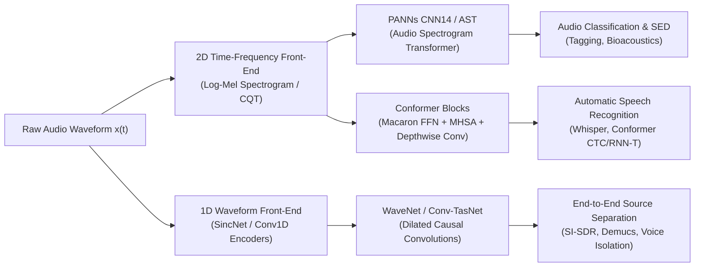

# The Complete Audio AI, Machine Learning & Digital Signal Processing (DSP) Engineering Handbook
### Industry Standard Methodology, Mathematical Formulations, Architecture Blueprints & European/German Hiring Benchmarks

> **Authoritative Engineering Reference**  
> Covers the full technical spectrum expected of Audio AI / DSP Engineers at European audio institutions and industry leaders (**Fraunhofer IIS / IDMT, Sennheiser / Neumann, Native Instruments, Ableton, Sonova, Harman, Bosch, Spotify**).

---

## 1. Industry Landscape & European Audio Hubs

| Sector | Key Employers (Germany & Europe) | Core Technical Focus | Typical Stack |
| :--- | :--- | :--- | :--- |
| **Pro Audio & Music Software** | Native Instruments (Berlin), Ableton (Berlin), Bitwig (Berlin), Sonible (Graz) | Music Information Retrieval (MIR), AI mixing/mastering assistants, neural audio synthesis, VST3/AU DAW plugins. | C++20, JUCE, Librosa, PyTorch, ONNX, SIMD (AVX/NEON) |
| **Acoustic Hardware & Microphones** | Sennheiser (Wedemark/Berlin), Neumann (Berlin), d&b audiotechnik (Backnang) | Active Noise Cancellation (ANC), multi-microphone beamforming, AMBEO spatial audio, smart conference isolation. | C/C++, Embedded DSP (SHARC, Tensilica), PyTorch, FxLMS |
| **Applied Research & Codecs** | Fraunhofer IIS (Erlangen), Fraunhofer IDMT (Ilmenau/Oldenburg) | Audio coding standards (MPEG, LC3, xHE-AAC), industrial predictive maintenance, spatial acoustics, hearing aids. | C/C++, MATLAB, PyTorch, Fixed-Point Q15/Q31, ITU Standards |
| **Hearing Health & Audiology** | Sonova / Phonak, Demant, WS Audiology (Erlangen/Denmark) | Ultra-low latency speech enhancement (< 5ms), binaural directional hearing, acoustic feedback cancellation. | C/C++, Ultra-low power DSP, DeepFilterNet, TinyML |
| **Automotive & Industrial AI** | Harman (Munich), Bosch (Stuttgart), Siemens (Munich), BMW | In-cabin acoustic voice tracking, Active Road Noise Cancellation (ARNC), AVAS sound synthesis, machine fault detection. | C++, Python, PyTorch, QNX, AUTOSAR, DCASE Protocols |
| **Streaming & Recommendation** | Spotify (Stockholm/Berlin), SoundCloud (Berlin), Deezer (Paris) | Semantic music tagging, song similarity, vector embedding retrieval, auto-tagging, loudness compliance (LUFS). | Python, PyTorch, CLAP/MERT, Annoy/FAISS, Docker, Kubernetes |

---

## 2. Pillar I: Signal Theory, LTI Systems & Digital Filter Design

### 2.1 The Sampling Theorem & Discrete Representations
- **Nyquist-Shannon Sampling Theorem**: A continuous bandlimited signal $x(t)$ with maximum frequency $f_{	ext{max}}$ can be perfectly reconstructed from its discrete samples $x[n] = x(n T_s)$ if and only if:
  $$f_s \ge 2 f_{	ext{max}} \quad 	ext{where } f_s = rac{1}{T_s}$$
- **Aliasing Distortion**: Frequencies above the Nyquist limit $f_N = f_s / 2$ fold back across the Nyquist boundary:
  $$f_{	ext{alias}} = |f - k f_s|$$
- **Antialiasing Requirement**: A steep low-pass filter must be applied *before* ADC conversion.
- **Quantization Noise & Dynamic Range**: For a uniform $B$-bit linear PCM converter, the theoretical Signal-to-Quantization-Noise Ratio (SQNR) is:
  $$	ext{SQNR} pprox 6.02 \cdot B + 1.76 	ext{ dB} \quad \implies 16	ext{-bit} pprox 98	ext{ dB}, \quad 24	ext{-bit} pprox 146	ext{ dB}$$

### 2.2 Linear Time-Invariant (LTI) Systems & the Z-Transform
- An LTI system is completely characterized by its impulse response $h[n]$:
  $$y[n] = (x * h)[n] = \sum_{k=-\infty}^\infty x[k] h[n-k]$$
- **The Z-Transform**:
  $$H(z) = \sum_{n=-\infty}^\infty h[n] z^{-n} = rac{\sum_{k=0}^M b_k z^{-k}}{\sum_{k=0}^N a_k z^{-k}} = b_0 rac{\prod_{k=1}^M (1 - c_k z^{-1})}{\prod_{k=1}^N (1 - d_k z^{-1})}$$
  - **Poles ($d_k$)**: Roots of the denominator. For stability, all poles must lie strictly inside the unit circle: $|d_k| < 1$.
  - **Zeros ($c_k$)**: Roots of the numerator. When zeros lie on the unit circle, they produce complete frequency notches.

### 2.3 Filter Topologies: FIR vs. IIR
| Attribute | Finite Impulse Response (FIR) | Infinite Impulse Response (IIR) |
| :--- | :--- | :--- |
| **Impulse Response** | Finite length ($N$ taps) | Infinite length (feedback recursive) |
| **Stability** | Inherently unconditionally stable (no poles except $z=0$) | Conditional (unstable if poles drift outside $|z| \ge 1$) |
| **Phase Response** | Strictly linear phase possible (symmetric coefficients: $h[n] = \pm h[N-1-n]$) | Non-linear phase (frequency-dependent group delay) |
| **Computational Efficiency** | High compute cost for sharp cutoffs (requires large $N$) | Extremely efficient (steep roll-off with low order, e.g. 2nd-order biquad) |
| **Standard Implementation** | FFT Fast Convolution (Overlap-Add / Overlap-Save) | Cascaded Biquad Second-Order Sections (Direct Form II Transposed) |

### 2.4 Biquad Second-Order Sections (Audio EQ Cookbook)
To avoid catastrophic numerical instability from coefficient quantization, all high-order IIR filters in industry are factored into second-order biquad sections (SOS):
$$y[n] = b_0 x[n] + b_1 x[n-1] + b_2 x[n-2] - a_1 y[n-1] - a_2 y[n-2]$$
- **Bilinear Transform with Frequency Pre-Warping**: Converts analog prototype $H_a(s)$ to digital $H_d(z)$ via $s = rac{2}{T_s} rac{1 - z^{-1}}{1 + z^{-1}}$ with pre-warping:
  $$\omega_a = rac{2}{T_s} 	an\left(rac{\omega_d T_s}{2}
ight)$$
- **Group Delay**: Measures the time delay of frequency components passing through the filter:
  $$	au_g(\omega) = -rac{d ngle H(e^{j\omega})}{d\omega}$$
  *(Unequal group delay smears transients, e.g. dulling the attack of a drum strike).*

---

## 3. Pillar II: Time-Frequency Analysis & Psychoacoustics

### 3.1 The Heisenberg-Gabor Uncertainty Principle
In signal processing, time and frequency resolutions cannot be simultaneously infinitesimally small:
$$\Delta t \cdot \Delta f \ge rac{1}{4\pi}$$
- **Short analysis window**: Sharp temporal precision, blurry frequency resolution (smears adjacent musical semitones).
- **Long analysis window**: Precise frequency resolution, blurry temporal resolution (smears transient attacks and drum hits).

### 3.2 Short-Time Fourier Transform (STFT)
$$X(m, \omega) = \sum_{n=-\infty}^\infty x[n] w[n - m H] e^{-j \omega n}$$
- **Window Functions $w[n]$**:
  - *Hann*: General-purpose audio analysis; $31	ext{ dB}$ sidelobe suppression; smooth roll-off.
  - *Blackman-Harris*: High-dynamic range audio ($92	ext{ dB}$ sidelobe rejection); prevents spectral leakage between loud harmonics and quiet overtones.
  - *Flattop*: Accurate sinusoidal amplitude calibration.
- **Overlap-Add (OLA) Constraint**: For perfect signal reconstruction in synthesis:
  $$\sum_{m=-\infty}^\infty w[n - m H] = 	ext{constant} \quad (	ext{e.g. Hann with } H = N/2 	ext{ or } N/4)$$

### 3.3 Psychoacoustics & Auditory Filterbanks
Human hearing is non-linear in frequency, loudness, and temporal integration:
1. **Equal Loudness Contours (ISO 226 / Fletcher-Munson)**:
   - The human ear is most sensitive between $2	ext{ kHz}$ and $5	ext{ kHz}$ (speech intelligibility band).
   - Low frequencies ($< 100	ext{ Hz}$) require significantly more sound pressure level (dB SPL) to be perceived as equally loud.
2. **Mel Scale**:
   $$m = 2595 \log_{10}\left(1 + rac{f}{700}
ight) \quad \iff \quad f = 700 \left(10^{rac{m}{2595}} - 1
ight)$$
   Models human pitch discrimination (linear below $1	ext{ kHz}$, logarithmic above $1	ext{ kHz}$).
3. **Equivalent Rectangular Bandwidth (ERB / Gammatone Filters)**:
   $$	ext{ERB}(f) = 24.7 \cdot (4.37 \cdot 10^{-3} f + 1)$$
   The gold standard in European audiology and hearing-aid research (Sonova, Fraunhofer) for modeling cochlear auditory filters.
4. **Constant-Q Transform (CQT)**:
   In musical systems, note frequencies follow a geometric progression ($f_k = f_0 \cdot 2^{k/B}$ where $B = 12, 24, 36	ext{ bins/octave}$). The Q-factor remains constant:
   $$Q = rac{f_k}{\Delta f_k} = rac{1}{2^{1/B} - 1}$$
   Provides fine frequency resolution for bass/chords, and fine time resolution for treble transients.

---

## 4. Pillar III: Spatial Audio, Microphone Arrays & Acoustics

### 4.1 Multi-Microphone Processing & Beamforming
Used extensively at Sennheiser, Harman automotive cabins, and conference systems:
1. **Delay-and-Sum Beamformer**:
   $$y[n] = rac{1}{M}\sum_{m=0}^{M-1} x_m[n - 	au_m]$$
   Aligns signals arriving from target direction of arrival (DoA) $	heta$ via steering delay $	au_m = rac{\mathbf{r}_m \cdot \mathbf{u}(	heta)}{c}$.
2. **Minimum Variance Distortionless Response (MVDR / Capon Beamformer)**:
   Minimizes total output power subject to unit gain in target direction:
   $$\mathbf{w}_{	ext{MVDR}} = rac{\mathbf{R}_{xx}^{-1} \mathbf{d}(	heta)}{\mathbf{d}^H(	heta) \mathbf{R}_{xx}^{-1} \mathbf{d}(	heta)}$$
   Suppresses directional interferers by steering spatial nulls toward jamming noise sources.
3. **Direction of Arrival (DoA) Estimation**:
   - *SRP-PHAT (Steered Response Power with Phase Transform)*: Robust against room reverberation.
   - *MUSIC (Multiple Signal Classification)*: Eigendecomposition of spatial covariance matrix into signal and noise subspaces.

### 4.2 Spatial Audio Formats & Binaural Rendering
1. **Binaural Audio & HRTF**:
   Humans localize sound via Interaural Time Difference (ITD: delay between ears, dominant below $1.5	ext{ kHz}$) and Interaural Level Difference (ILD: head acoustic shadow, dominant above $1.5	ext{ kHz}$).
   $$y_L[n] = x[n] * 	ext{HRIR}_L(	heta, \phi), \quad y_R[n] = x[n] * 	ext{HRIR}_R(	heta, \phi)$$
2. **Ambisonics (Higher-Order Ambisonics HOA)**:
   Represents spatial soundfields as spherical harmonic expansions independent of physical speaker layout:
   $$P(r, 	heta, \phi, k) = \sum_{l=0}^\infty \sum_{m=-l}^l A_l^m j_l(kr) Y_l^m(	heta, \phi)$$
   Decoded to any playback system (headphones via binaural HRTF, 5.1, 7.1.4 Dolby Atmos) at runtime.

---

## 5. Pillar IV: Audio Deep Learning Architectures



### 5.1 2D Spectrogram Convolutional Networks & Transformers
1. **PANNs (Pretrained Audio Neural Networks - CNN14)**:
   - 14-layer deep convolutional backbone operating on 64-bin log-mel spectrograms.
   - Global pooling (average + max) across time-frequency channels; standard transfer learning baseline for environmental sound tagging.
2. **Audio Spectrogram Transformer (AST)**:
   - Pure attention architecture operating on 2D audio spectrograms.
   - Splits log-mel spectrogram into $16 	imes 16$ patches with $50\%$ temporal and frequency overlap.
   - Adds learnable 1D/2D positional embeddings and processes via standard Vision Transformer (ViT) blocks.

### 5.2 1D Raw Waveform Processing: Dilated Causal Convolutions
1. **WaveNet**:
   - Causal convolutions ensure prediction at time step $t$ depends only on past samples $x[0], \dots, x[t-1]$.
   - Exponentially dilated convolutions ($d = 1, 2, 4, 8, \dots, 512, 1, 2, \dots$) scale the receptive field to thousands of samples:
     $$(x *_{d} f)[t] = \sum_{k=0}^{K-1} f[k] \cdot x[t - d \cdot k]$$
   - Gated Activation Units: $z = 	anh(W_{f,k} * x) \odot \sigma(W_{g,k} * x)$.
2. **SincNet**:
   - Replaces unconstrained first-layer 1D convolutions with parameterized sinc bandpass filters:
     $$g[n, f_1, f_2] = 2 f_2 	ext{sinc}(2\pi f_2 n) - 2 f_1 	ext{sinc}(2\pi f_1 n)$$
   - Only cutoff frequencies $f_1, f_2$ are updated by backpropagation; guarantees physically meaningful auditory filterbanks.

### 5.3 Conformer Architecture (ASR & Speech Translation)
Combines the global context modeling of self-attention with the local shift-invariance of convolutions:
$$	ext{Output} = x + rac{1}{2}	ext{FFN}(x) + 	ext{MHSA}(x) + 	ext{Conv}(x) + rac{1}{2}	ext{FFN}(x)$$
- Depthwise separable convolutions reduce parameter counts while preserving high temporal resolution.

---

## 6. Pillar V: Source Separation, Active Noise Cancellation & Speech Enhancement

### 6.1 Hybrid Demucs Source Separation Architecture
- **Dual-Domain Processing**: Employs parallel U-Net encoders in both time domain (raw waveform convs) and frequency domain (complex STFT spectrogram convs).
- **Latent Cross-Domain Fusion**: Features are concatenated and processed through bidirectional LSTM sequence layers to model musical verse/chorus structure.
- **Multi-Scale STFT Loss**:
  $$\mathcal{L}_{STFT} = \sum_{s \in \mathcal{S}} \left( rac{\||X_s| - |\hat{X}_s|\|_F}{\||X_s|\|_F} + rac{1}{N} \|\log |X_s| - \log |\hat{X}_s|\|_1 
ight)$$

### 6.2 Active Noise Cancellation (ANC): Filtered-X LMS (FxLMS)
Standard in headphones (Sennheiser, Bose) and automotive cabins (Harman, Bosch):
1. Primary path $P(z)$ models acoustic path from noise source to error microphone.
2. Secondary path $S(z)$ models D/A converter, amplifier, loudspeaker, and acoustic distance to error microphone.
3. **FxLMS Adaptive Weight Update**:
   $$w(n+1) = w(n) + \mu e(n) x'(n) \quad 	ext{where } x'(n) = \hat{s}(n) * x(n)$$
   where $\hat{S}(z)$ is an offline-estimated model of the secondary acoustic path.

---

## 7. Pillar VI: Foundation Models & Neural Audio Codecs

| Model | Modality & Pretraining Objective | Architecture | Latent Space | Typical Application |
| :--- | :--- | :--- | :--- | :--- |
| **Wav2Vec 2.0** | Self-supervised masked acoustic frame prediction via contrastive task | 1D CNN encoder + Transformer | Continuous latent quantized via Gumbel-Softmax | Speech Recognition (ASR), emotion recognition |
| **HuBERT** | Masked prediction of discrete acoustic cluster labels ($k$-means on MFCCs/features) | 1D CNN + Transformer | 768-D / 1024-D representations | Robust speech representation, phoneme recognition |
| **CLAP** | Contrastive Language-Audio Pretraining on paired text descriptions and audio | HTS-Audio Transformer + RoBERTa | 512-D joint multimodal embedding | Text-to-audio search, zero-shot audio tagging |
| **MERT** | Masked Acoustic Modeling predicting discrete CQT and speech units | Transformer encoder | 768-D music representation | Music tagging, chord recognition, pitch/genre analysis |
| **EnCodec / DAC** | Neural Audio Codec using Residual Vector Quantization (RVQ) | Multi-scale Conv1D + RVQ + Vocoder | Discrete multi-stream tokens (1.5 - 24 kbps) | Ultra-low bitrate transmission, generative audio tokens |
| **HiFi-GAN** | Generative Adversarial Network for high-fidelity waveform synthesis | Multi-Period (MPD) + Multi-Scale Discriminator | Mel-spectrogram to raw audio | Universal neural vocoder for TTS and music generation |

---

## 8. Pillar VII: Standardized Audio Evaluation Metrics

### 8.1 Speech Intelligibility & Quality (ITU Standards)
- **PESQ (Perceptual Evaluation of Speech Quality - ITU-T P.862)**:
  Scores speech quality from $-0.5$ to $4.5$ (MOS mapping: $1.0$ to $4.5$). Compares clean reference with degraded speech using psychoacoustic loudness warps and disturbance density calculations.
- **POLQA (Perceptual Objective Listening Quality Assessment - ITU-T P.863)**:
  Modern successor to PESQ; supports super-wideband ($32	ext{ kHz}$) and fullband ($48	ext{ kHz}$) audio networks.
- **STOI (Short-Time Objective Intelligibility)**:
  Correlates intermediate time-frequency representations across $384	ext{ ms}$ chunks; outputs an intelligibility score between $0.0$ and $1.0$.

### 8.2 Source Separation Metrics
- **BSS-Eval v4 (SDR, SIR, SAR)**:
  Decomposes estimated source $\hat{s}$ into target, interference, and artifact components:
  $$\hat{s}(t) = s_{	ext{target}}(t) + e_{	ext{interf}}(t) + e_{	ext{artif}}(t) + e_{	ext{noise}}(t)$$
  $$	ext{SDR} = 10 \log_{10} rac{\|s_{	ext{target}}\|^2}{\|e_{	ext{interf}} + e_{	ext{artif}} + e_{	ext{noise}}\|^2}, \quad 	ext{SIR} = 10 \log_{10} rac{\|s_{	ext{target}}\|^2}{\|e_{	ext{interf}}\|^2}$$
- **Scale-Invariant Signal-to-Distortion Ratio (SI-SDR)**:
  Standard metric in modern MIR/speech separation; invariant to global scalar volume scaling:
  $$	ext{SI-SDR} = 10 \log_{10} \left( rac{\|lpha s\|^2}{\|\hat{s} - lpha s\|^2} 
ight) \quad 	ext{where } lpha = rac{\hat{s}^T s}{\|s\|^2}$$

---

## 9. Pillar VIII: Real-Time Audio C++, JUCE & Embedded Edge ML

### 9.1 The Real-Time Audio Thread Contract (Absolute Rules)
In commercial audio software (VST3/AU plugins in Ableton/Logic/Pro Tools) and embedded firmware, audio rendering occurs in an elevated, high-priority real-time audio thread:
$$	ext{Buffer Budget: } T_{	ext{block}} = rac{	ext{samplesPerBlock}}{f_s} \quad \implies rac{128	ext{ samples}}{48000	ext{ Hz}} = 2.67	ext{ ms}$$

> [!CAUTION]
> **Violating Real-Time Safety Rules Triggers Buffer Under-Runs (Audio Dropouts, Glitches & Crashes)**  
> Inside the audio processing callback (`processBlock()` in JUCE):
> 1. **NEVER allocate or free memory dynamically**: No `malloc()`, `free()`, `new`, `delete`, or resizing containers (`std::vector::push_back`). All scratch buffers must be pre-allocated in `prepareToPlay()`.
> 2. **NEVER acquire blocking locks**: No `std::mutex::lock()`, conditional variables, or semaphores. Use lock-free circular FIFO ring buffers (`juce::AbstractFifo` or `moodycamel::ReaderWriterQueue`).
> 3. **NEVER make operating system calls**: No file I/O, console logging (`std::cout`, `printf`), UI rendering calls, or network calls.
> 4. **Avoid denormal floating-point numbers**: Floating-point values extremely close to zero trigger CPU microcode fallback, causing 100x CPU spikes. Always enable Flush-To-Zero (FTZ) and Denormals-Are-Zero (DAZ):
>    ```cpp
>    juce::ScopedNoDenormals noDenormals;
>    ```

### 9.2 Real-Time Audio Plugin Architecture (JUCE Framework)
```cpp
// Modern JUCE VST3/AU Audio Processor Example
void AudioPluginAudioProcessor::prepareToPlay (double sampleRate, int samplesPerBlock)
{
    // 1. Pre-allocate all buffers and initialize DSP engines
    juce::dsp::ProcessSpec spec;
    spec.sampleRate = sampleRate;
    spec.maximumBlockSize = samplesPerBlock;
    spec.numChannels = getTotalNumOutputChannels();

    filterSection.prepare(spec);
    inferenceBuffer.setSize(spec.numChannels, spec.maximumBlockSize);
}

void AudioPluginAudioProcessor::processBlock (juce::AudioBuffer<float>& buffer, juce::MidiBuffer& midiMessages)
{
    // 2. Real-time audio callback: STRICTLY deterministic execution
    juce::ScopedNoDenormals noDenormals;

    // Process biquad IIR filter section (SIMD vectorized)
    juce::dsp::AudioBlock<float> block (buffer);
    filterSection.process(juce::dsp::ProcessContextReplacing<float>(block));

    // Send audio to background ML inference thread via lock-free FIFO
    lockFreeFifo.writeSamples(buffer.getReadPointer(0), buffer.getNumSamples());
}
```

### 9.3 Embedded Edge Audio & Fixed-Point DSP
1. **Fixed-Point Fractional Arithmetic (Q15 / Q31)**:
   Many ultra-low-power DSP chips (hearing aids, battery microcontrollers) lack hardware floating-point units (FPUs):
   - **Q15 format**: 1 sign bit + 15 fractional bits. Represents values in $[-1.0, 1.0 - 2^{-15}]$:
     $$x_{	ext{int}} = 	ext{clamp}(	ext{round}(x_{	ext{float}} \cdot 2^{15}), -32768, 32767)$$
   - Multiplication of two Q15 numbers yields Q30, requiring a 15-bit arithmetic right shift with saturation to prevent integer overflow wrap-around distortion.
2. **CMSIS-DSP Acceleration**:
   ARM Cortex-M processors use CMSIS-DSP SIMD instructions (`__SMLAD`, `vld1q_f32`) to execute 4 parallel multiply-accumulate operations per clock cycle for real-time convolution and Biquad filtering.
3. **Quantization & Edge Inference (ONNX / TFLite Micro)**:
   - Quantization-Aware Training (QAT) maintains high accuracy when compressing weights from FP32 to INT8.
   - Run inference via ONNX Runtime Mobile or TensorFlow Lite for Microcontrollers within tiny SRAM footprints ($< 256	ext{ KB}$).

---

## 10. Technical Interview Trap Checklist (European & German Hiring Standards)

| Topic | The Naive Candidate's Mistake | The Senior Audio DSP / ML Answer |
| :--- | :--- | :--- |
| **Filter Design** | Implements high-order IIR filters as direct-form polynomials. | Direct-form polynomials suffer catastrophic coefficient quantization instability. Always cascade 2nd-order Biquad sections (SOS) with frequency pre-warping. |
| **Spectral Phase** | Reconstructs waveforms using mixture phase with an estimated magnitude mask. | Causes severe musical noise and phase smearing. Uses complex spectral masks (predicting real and imaginary components) or end-to-end waveform U-Nets. |
| **Audio Thread** | Allocates a buffer or acquires a mutex inside `processBlock()`. | Causes audio dropouts and crashes the host DAW. Strictly pre-allocates memory in `prepareToPlay()` and communicates via lock-free atomics/FIFOs. |
| **Separation Metric** | Evaluates source separation using Mean Squared Error (MSE). | Audio MSE is hypersensitive to imperceptible sample delays. Always uses Scale-Invariant SDR (SI-SDR) or BSS-Eval v4 (SDR/SIR/SAR). |
| **Loudness** | Normalizes tracks using maximum peak amplitude (0 dBFS). | Peak normalization ignores human psychoacoustics. Conforms strictly to ITU-R BS.1770-4 Integrated Loudness (LUFS) with gating thresholds. |
| **Validation Split** | Randomly shuffles sliding audio windows across train/test sets. | Adjacent overlapping windows share identical acoustic context. Strictly partitions cross-validation by Artist, Speaker, or Recording Room ID. |
| **Resampling** | Resamples audio using linear interpolation or naive decimation. | Downsampling without steep low-pass filtering causes high-frequency aliasing folding into the audible band. Always uses polyphase sinc interpolation. |
